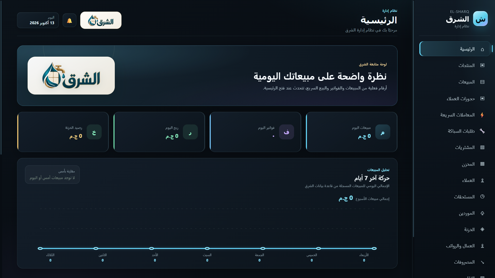
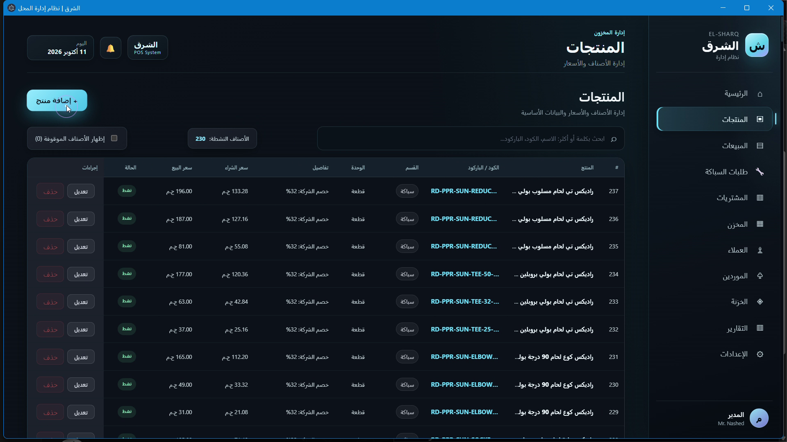
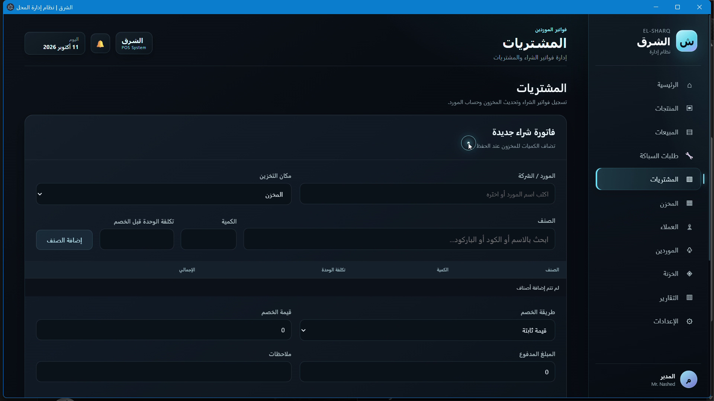

# 🏢 El-Sharq Inventory & POS System | نظام الشرق لإدارة معارض ومحلات السيراميك والسباكة

<div align="center">


**نظام مكتبي (Desktop ERP / POS) متكامل لإدارة معارض ومخازن السيراميك، الأدوات الصحية، والسباكة في السوق المصري.**  
مصمم ليعمل بدون إنترنت (Offline-First) بكفاءة وسرعة فائقة مع مراعاة معادلات التسعير التجارية المعقدة.

[المميزات](#-أبرز-المميزات) • [التقنيات المستخدمة](#-التقنيات-المستخدمة-tech-stack) • [هيكل المشروع](#-هيكل-المشروع) • [التشغيل والتركيب](#-طريقة-التشغيل)

</div>

---

## 🖥️ لقطات من النظام

لقطات حقيقية من واجهة التطبيق أثناء تشغيله. قد تختلف بعض التفاصيل والبيانات الظاهرة عن أحدث نسخة؛ لا تتضمن الصور قاعدة البيانات أو معلومات عملاء.

<p align="center">
  
</p>
<p align="center"><strong>لوحة التحكم</strong></p>

<p align="center">
  
</p>
<p align="center"><strong>إدارة المنتجات</strong></p>

<p align="center">
  
</p>
<p align="center"><strong>إدخال المشتريات</strong></p>

---

## 🌟 أبرز المميزات (Key Features)

### 1. 🔍 محرك بحث واقتراح ذكي فوري (Smart Autocomplete Search)
- بحث لحظي وسريع جداً بين آلاف الأصناف بالاسم، الكود، المقاس، أو الباركود.
- تحكم كامل من خلال لوحة المفاتيح (الأسهم للأعلى والأسفل، `Enter` للاختيار الفوري، و`Esc` للإغلاق) لتسريع عمليات البيع في أوقات الذروة.

### 2. 🚿 معادلات تسعير السباكة والمشتريات (Plumbing & Ceramic Pricing Engine)
- **السباكة:** دعم خصم اللستة التجاري (حساب التكلفة آلياً من نسبة خصم المورد مع تحديد سعر البيع القطاعي).
- **السيراميك والأدوات الصحية:** شراء مباشر وتحديد فوري لسعر البيع ونسب الأرباح.
- حفظ تاريخ الأسعار والتراجع الآمن عند إلغاء أو تعديل الفواتير.

### 3. 📦 إدارة المخزون متعدد المواقع وحجز البضاعة (Multi-Location & Reservations)
- تتبع حركة الأرصدة بدقة بين **المعرض** و**المخزن**.
- **نظام حجز البضاعة:** إمكانية حجز بضاعة للعميل بعربون وتثبيت سعر الشراء اليوم حتى موعد الاستلام، مع التحقق من الرصيد المتاح بالمخازن وتوزيع الصرف الفعلي عند التسليم.

### 4. 💰 الخزينة، المصروفات، والأرباح (Cash Management & Expenses)
- إدارة الخزائن النقدية وحركات الإيداع والسحب.
- صفحة مخصصة لتسجيل المصروفات النثرية واليومية مع ربط الخصم بالخزينة وخصمها من صافي الأرباح في التقارير.
- كشف حساب تفصيلي للطباعة وتقارير أرباح دقيقة.

### 5. 📑 طباعة الفواتير وكشوف الحساب (Invoicing & Printing)
- فواتير بيع وشراء مخصصة جاهزة للطباعة الحرارية ومقاس A4/A5.
- تجميع البنود حسب الأقسام (سباكة، سيراميك، أدوات صحية) مع تفاصيل الخصومات والصافي.

### 6. ⚡ استيراد الكتالوجات الضخمة (Automated Catalog Importer)
- محرك استيراد وتدقيق آلي تم من خلاله إدخال وفهرسة أكثر من 850 صنفاً من كبرى الشركات المصرية والعالمية (سانيبيور Sanipure، هوايي HUAYE، وراديكس Radix) وتوليد أكواد فريدة وربط أرصدة المخازن آلياً.

---

## 🛠️ التقنيات المستخدمة (Tech Stack)

| المجال | التقنية | الاستخدام |
| :--- | :--- | :--- |
| **Runtime** | `Electron.js` | تشغيل التطبيق المكتبي على نظام Windows بأداء خفيف وسريع |
| **Backend & Engine** | `Node.js` | إدارة العمليات الحسابية والمنطق التجاري (Business Logic) |
| **Database** | `SQLite` via `better-sqlite3` | قاعدة بيانات محلية سريعة جداً تعمل بنظام Transactions متزامن |
| **Frontend** | `HTML5`, `CSS3`, `Vanilla JavaScript` | واجهة مستخدم متجاوبة وسلسة بدون استهلاك زائد للذاكرة |
| **Security & IPC** | `Electron contextBridge` & `preload.js` | عزل آمن بين عمليات الواجهة وقاعدة البيانات |

---

## 📂 هيكل المشروع (Project Architecture)

```text
El-Sharq/
├── main.js                   # نقطة انطلاق تطبيق Electron وإدارة النوافذ
├── src/
│   ├── preload.js            # جسر الأمان وعرض الـ APIs للواجهة (IPC Bridge)
│   ├── database/
│   │   ├── database.js       # إعداد وتهيئة جداول SQLite والـ Migrations
│   │   ├── operations.js     # العمليات المحاسبية وإدارة المنتجات والفواتير
│   │   └── data/             # ملف قاعدة البيانات المحلي (el-sharq.db)
│   └── renderer/
│       ├── index.html        # الواجهة الرسومية الرئيسية
│       ├── app.js            # إدارة التنقل وتبديل الشاشات
│       ├── operations.js     # منطق واجهات البيع، الشراء، والبحث الذكي
│       ├── invoice-print.js  # محرك تنسيق وطباعة الفواتير
│       ├── style.css         # التنسيقات والتصميم المرئي
│       └── assets/           # الشعار والأيقونات والخطوط
├── import-catalogs.js        # سكربت استيراد وتدقيق كتالوجات الأصناف
└── package.json              # إعدادات المشروع وحزم Node.js
```

---

## 🚀 طريقة التشغيل (Getting Started)

### المتطلبات المسبقة:
- تثبيت [Node.js](https://nodejs.org/) (إصدار 18 أو أحدث).

### خطوات التشغيل:
```bash
# 1. استنساخ المشروع
git clone https://github.com/jacob8110/el-sharq-inventory.git

# 2. الدخول إلى مجلد المشروع
cd el-sharq-inventory

# 3. تثبيت الاعتماديات
npm install

# 4. تشغيل التطبيق في وضع التطوير
npm start
```

---


## الترخيص والتفعيل (License & Activation)

هذا المستودع منشور لمراجعة الكود وعرض المشروع في ملف الأعمال، وليس ترخيصًا عامًا لإعادة الاستخدام أو التوزيع. راجع ملف `LICENSE`؛ وقد ضُبط حقل الترخيص في `package.json` على `UNLICENSED` حتى لا يتعارض مع شروط الملكية الخاصة.

يتحقق التطبيق عند بدء التشغيل من ملف ترخيص موقّع بـ Ed25519 ومطابق لمعرّف الجهاز. ملف الترخيص وأداة التوقيع والمفتاح الخاص غير مضمنة في المستودع. هذا فحص ترخيص داخل تطبيق عميل، وليس حماية غير قابلة للتجاوز: يستطيع شخص يملك نسخة من المصدر تعديلها أو بناء نسخة أخرى، لذلك لا يُضمن منع التشغيل أو التعديل تقنيًا. كما أن معرّف الجهاز المستخدم قد يتأثر بتغييرات الجهاز أو النظام.

لذلك فإن خطوات التشغيل أدناه تحتاج ملف ترخيص صالحًا لم يُنشر مع الكود؛ المستودع مناسب لمراجعة المصدر، وليس نسخة عامة جاهزة للتشغيل.

## 👨‍💻 المطور (Author)

**يعقوب أشرف (Yacoub Ashraf)**  
- GitHub: [@jacob8110](https://github.com/jacob8110)  
- Contact: jacobashraf6@gmail.com

---

<div align="center">
  <sub>صُنع بشغف لخدمة أصحاب الأعمال في قطاع المقاولات والتجارة في مصر 🇪🇬</sub>
</div>
